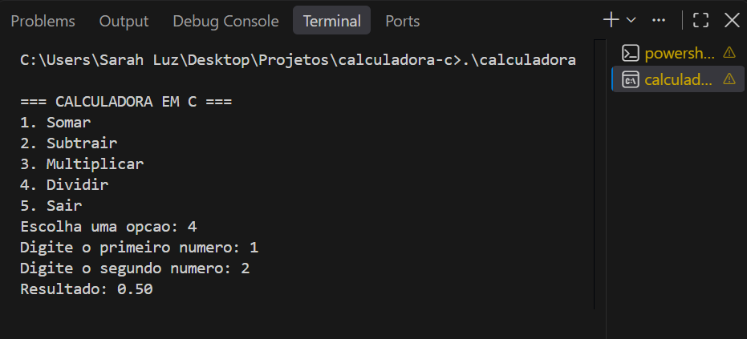

# Calculadora Interativa em C

Uma aplicação de terminal (CLI) interativa, rápida e amigável desenvolvida em **Linguagem C**. O projeto oferece uma interface via linha de comando organizada por menus para que o usuário execute cálculos aritméticos básicos e operações avançadas de forma intuitiva.


---

## 1. Título e Descrição

### Sobre o Projeto
A **Calculadora Interativa em C** foi projetada para demonstrar boas práticas de desenvolvimento na linguagem C, como modularização de código, manipulação limpa de entrada/saída de dados no terminal e prevenção de erros comuns em tempo de execução (como divisão por zero e raízes quadradas de números negativos).

### Principais Funcionalidades
- **Operações Básicas:** Soma, Subtração, Multiplicação e Divisão.
- **Operações Avançadas:** Potenciação e Raiz Quadrada.
- **Interface Limpa:** Menu interativo no terminal com opção de continuar executando até que o usuário solicite a saída.
- **Tratamento de Erros:** Validações para evitar travamentos ou comportamentos indefinidos ao digitar dados inválidos.

---

## 2. Demonstração

Abaixo está uma representação visual do funcionamento do sistema no terminal:

```text
==================================================
           CALCULADORA INTERATIVA EM C            
==================================================
  [1] Adição (+)
  [2] Subtração (-)
  [3] Multiplicação (*)
  [4] Divisão (/)
  [5] Potenciação (^)
  [6] Raiz Quadrada (√)
  [0] Sair do Programa
==================================================
Escolha uma opção: 4

Digite o primeiro número (dividendo): 50
Digite o segundo número (divisor): 2.5

--------------------------------------------------
Resultado: 50.00 / 2.50 = 20.00
--------------------------------------------------

Pressione ENTER para retornar ao menu...

---

## 📸 Demonstração



---

## 🛠️ Instalação e Pré-requisitos

### Pré-requisitos

Para compilar e executar o código em C, é necessário ter um compilador C instalado no seu sistema operacional, como o **GCC** (GNU Compiler Collection).

#### Como verificar a instalação do GCC:
Abra o terminal e execute:
```bash
gcc --version